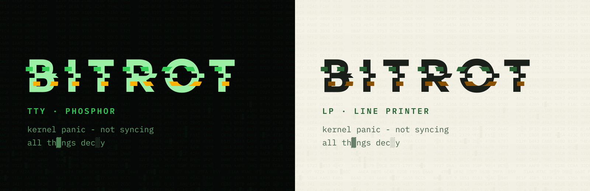

<p align="center"></p>

<p align="center"><sub>kernel panic - not syncing<br>
all th▓ngs dec░y</sub></p>

# ▓▒░ BITROT

A phosphor terminal whose memory is slowly decaying. Everything sits on a monospace grid, fills are shades (░ ▒ ▓ █) and corners are square. The glitch is **the slice**: a horizontal band displaced sideways by whole cells, splitting into a green and an amber ghost. It is allowed in only a few places: the lock clock, the prayer banner's name, the window border, the bar's two ends, the wallpaper and the title of a critical notification. Green is structure and text, amber is the one thing that has focus or is near, and red appears only where bytes really went wrong.

| | |
|---|---|
| **bitrot-tty** | a CRT: black glass, green and amber phosphor, a faint bloom on the focused window |
| **bitrot-lp** | the same output on line-printer paper: pale green bars, ribbon ink, no glow |

## ░ Palette

| | | |
|---|---|---|
| **ground** | `#050806 / #F4F1E6` | tty / lp |
| **text** | `#9CF0A6 / #1A1F1A` |  |
| **structure** | `#33CC55 / #2A6334` | frames, blocks, the green ghost |
| **attention** | `#FFB000 / #8A5200` | focus, near, due, the amber ghost |
| **data** | `#CFE3CC / #2B3A2D` | values that change |
| **error** | `#FF6A55 / #A3180F` | real failure only |

## ▒ Memory map

- **Windows**: square, opaque, no blur; the focused border carries an amber band, the
  tty variant adds a green bloom; the wallpaper is a memory dump rotting into shades
- **Waybar**: one flat 26px bar with sliced end caps; workspaces are shade cells
  ░ ▒ ▓ █, NET / SYS / ••• drawers, VOL, BAT, NOTIF, IDLE, YAWM
- **mawaqit**: the next prayer and its iqama; adhan (green) and iqama (amber) banners
  with the prayer's name sliced
- **yawm**: █ overdue (red), ▓ today (amber), ▒ later, ░ undated, ¶ notes
- **hyprlock**: the clock is an image re-rendered every minute with the slice; the
  rotating lines are old system messages and rotted words; a wrong password answers
  `Abort, Retry, Fail?`
- **BitrotTty / BitrotLp** icons built from shade cells with one shifted row, the
  **BitrotTtyCell / BitrotLpCell** cursors (busy is a ▁▂▃▄▅▆▇█ ramp), **GTK / Thunar**,
  **swaync**
- **Terminals**: foot, alacritty, ghostty; tmux and zsh close their segments with a
  ▓▒░ smear
- **Type**: Sora, IBM Plex Sans, IBM Plex Mono, with Amiri and IBM Plex Sans Arabic

## ░ Requirements

- Arch Linux (the package check uses `pacman`)
- Hyprland 0.56 or newer: the configuration is written in Lua
- waybar 0.15 or newer
- the packages in `bitrot-tty/packages.txt` (both variants need the same):

```sh
sudo pacman -S --needed $(grep -v '^#' bitrot-tty/packages.txt)
```

## ▓ boot

> [!WARNING]
> This is a whole desktop, not a colour scheme. It replaces every file listed
> in `bitrot-tty/MANIFEST` or `bitrot-lp/MANIFEST`: the Hyprland, waybar, terminal, tmux, GTK and fontconfig
> configuration among them, and the theme line in `~/.zshrc`.
> Everything it replaces is backed up first.

```sh
git clone https://github.com/houssemMekhelbi/bitrot.git
cd bitrot
./bitrot-tty/restore.sh --dry-run   # show what would change, touch nothing
./bitrot-tty/restore.sh             # apply bitrot-tty
./bitrot-lp/restore.sh              # or bitrot-lp
```

`restore.sh` then:

1. reports missing packages;
2. backs up every path it is about to replace to `~/themes/.backups/before-<variant>-<timestamp>/`;
3. copies the theme's `home/` over `$HOME` and removes the paths in its `ABSENT`;
4. points `~/.zshrc` at the theme's prompt;
5. applies its `gsettings.txt` and refreshes the font and icon caches;
6. builds the mawaqit-api image if it is missing, enables the user services and
   reloads Hyprland, waybar, hyprpaper, swaync and tmux.

`--files-only` copies the files and gsettings and leaves the services alone.

## ░ core dump

To go back, copy the backup folder back over `$HOME`.

## ░ Prayer times

Prayer times come from [mawaqit.net](https://mawaqit.net) through a local copy of
[mawaqit-api](https://github.com/mrsofiane/mawaqit-api), run by podman on 127.0.0.1.
List your mosques in `~/.config/mawaqit/mosques`, one `<mawaqit.net slug> | <label>`
per line; scroll or right-click the prayer module to switch between them.

## ▒ The other terminals

This is one of the hattin themes. They share one behaviour (binds, workspaces,
bar modules) and differ only in look. Clone several side by side and run the
`restore.sh` of the one you want: each switch removes what the previous theme
left that the new one does not use.

## ░ Licence

MIT, see [LICENSE](LICENSE). The fonts in `<theme>/home/.local/share/fonts/` are
under the SIL Open Font License; each licence text sits next to its font.
mawaqit-api (`<theme>/home/.local/share/mawaqit-api/`) is MIT, © Sofiane Louchene.
